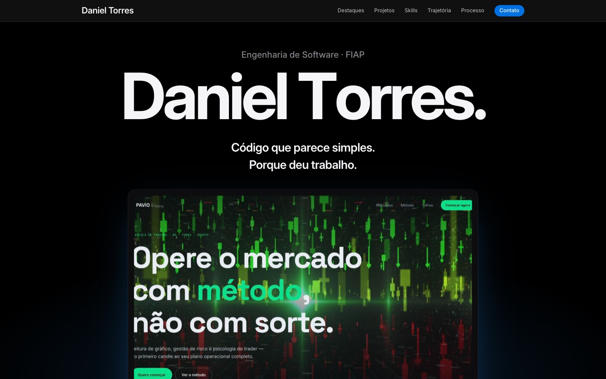

# Portfólio — Daniel Torres

Checkpoint 6 · Vibecoding — *Construindo uma landing page com IA* (FIAP · Engenharia de Software).

Portfólio inspirado nas páginas de produto da Apple: cada projeto é apresentado como um produto, numa vitrine escura, com o scroll contando a história. Desenvolvido com IA generativa (Claude Code), a partir das minhas referências e decisões de design.

| | |
|---|---|
| **Deploy** | https://portfolio-daniel-torres-three.vercel.app |
| **Processo** | https://portfolio-daniel-torres-three.vercel.app/processo.html |
| **Repositório** | https://github.com/D4NIELT0RRES/portfolio-daniel |



## Entregas do checkpoint

Toda a documentação está na pasta [`registros/`](registros/), um arquivo por item do enunciado:

| Item | Documento | Resumo |
|---|---|---|
| 3.1 Referências | [referencias.md](registros/referencias.md) | 8 referências (MacBook Pro, AirPods Pro, iPhone, blocos bento, GSAP, Lenis, PAVIO, Linear) com capturas em [`registros/referencias/`](registros/referencias/) |
| 3.2 Identidade visual | [idv.md](registros/idv.md) | Paleta, tipografia, tom, títulos e estrutura |
| 3.3 Prompts | [prompts.md](registros/prompts.md) | Prompts exatos, análise crítica e versão reescrita do prompt inicial |
| 3.4 Correções | [correcoes.md](registros/correcoes.md) | 10 fichas de correção, QA final e a evolução do processo |
| 3.5 Resultado | [reflexao.md](registros/reflexao.md) | Links, prints e reflexão |

## Identidade visual

**Conceito:** meus projetos como produtos.

| Cor | Papel |
|---|---|
| `#000000` | Fundo "palco" (hero, skills, contato) |
| `#F5F5F7` | Fundo claro (destaques, projetos, trajetória) |
| `#1D1D1F` | Texto principal |
| `#86868B` | Texto secundário |
| `#2997FF` | Destaque e links |
| `#2997FF → #BF5AF2` | Degradê de assinatura, só em palavras-chave e números |

**Tipografia:** Inter (títulos 600–700, espaçamento negativo) e JetBrains Mono (etiquetas de tecnologia).
**Tom:** confiante, minimalista, direto. Frases curtas com ponto final.

## Estrutura da página

Hero → Manifesto → Números → Destaques → Projetos em detalhe → Skills → Trajetória → Contato. Detalhes e justificativa em [idv.md](registros/idv.md#estrutura-da-página).

## Stack

Vite · GSAP (ScrollTrigger + SplitText) · Lenis · HTML/CSS/JS · Vercel · Claude Code

## Estrutura do repositório

```
├── index.html          # portfólio
├── processo.html       # página de processo (3.1 a 3.5)
├── src/                # main.js (animações) e style.css (tokens de IDV)
├── public/img/         # capturas dos projetos
└── registros/          # documentação do checkpoint
    ├── referencias/    # capturas das referências
    ├── prints/         # capturas do resultado (desktop e celular)
    └── *.md            # referências, IDV, prompts, correções, reflexão
```

## Rodar localmente

```bash
npm install
npm run dev
```
