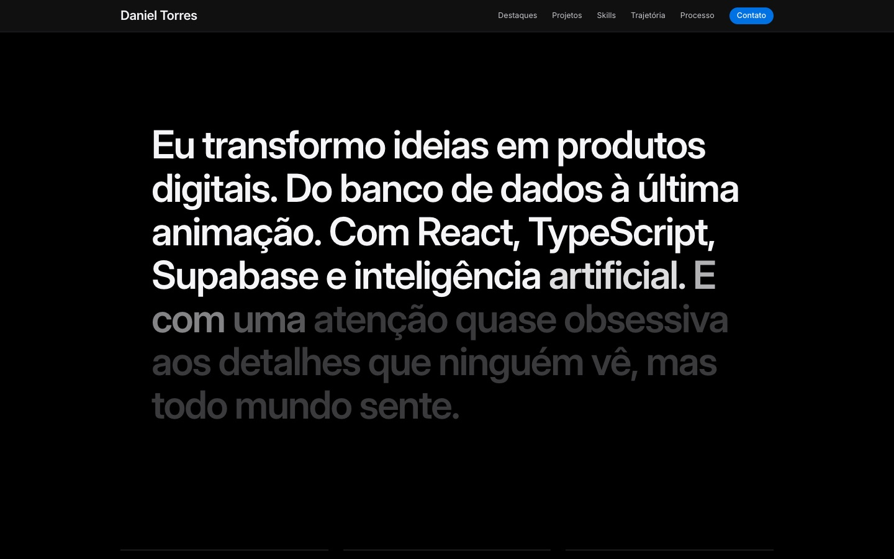
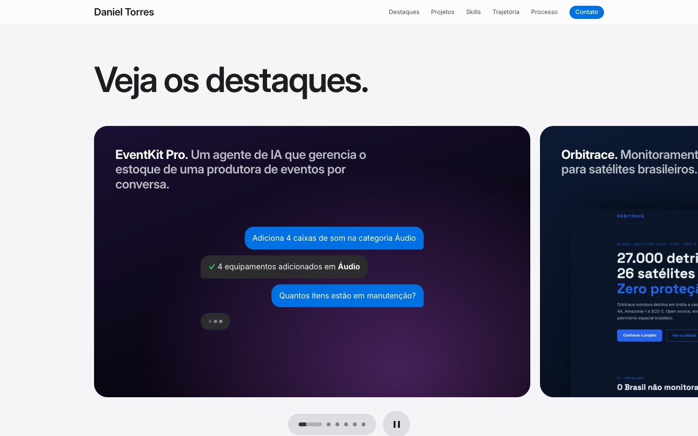
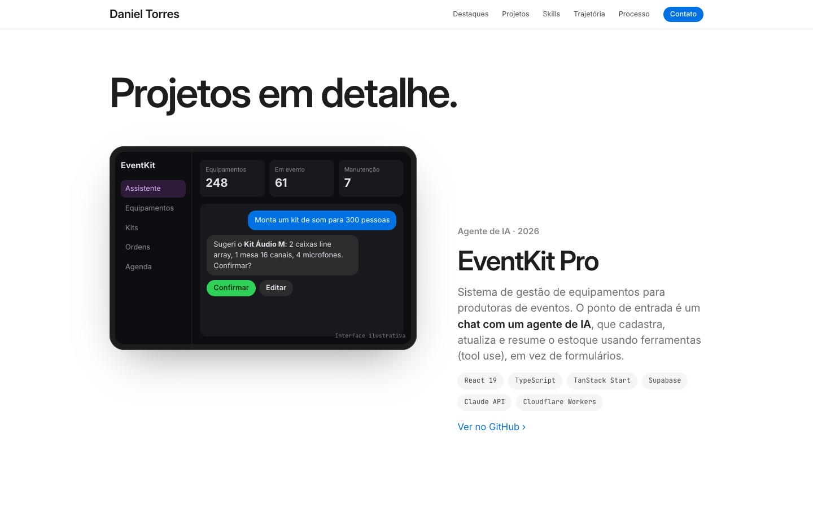
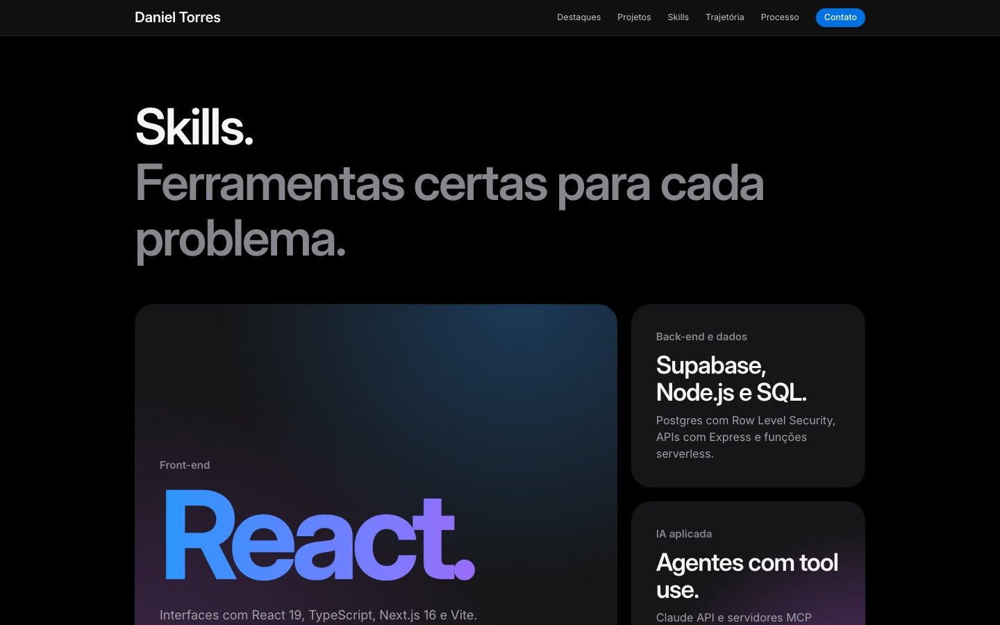
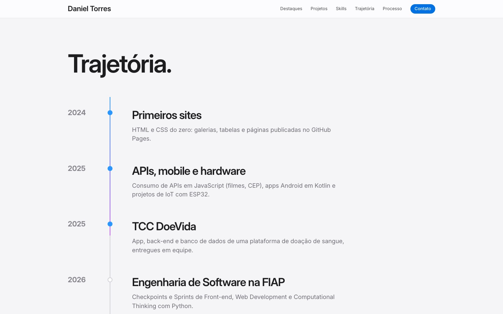
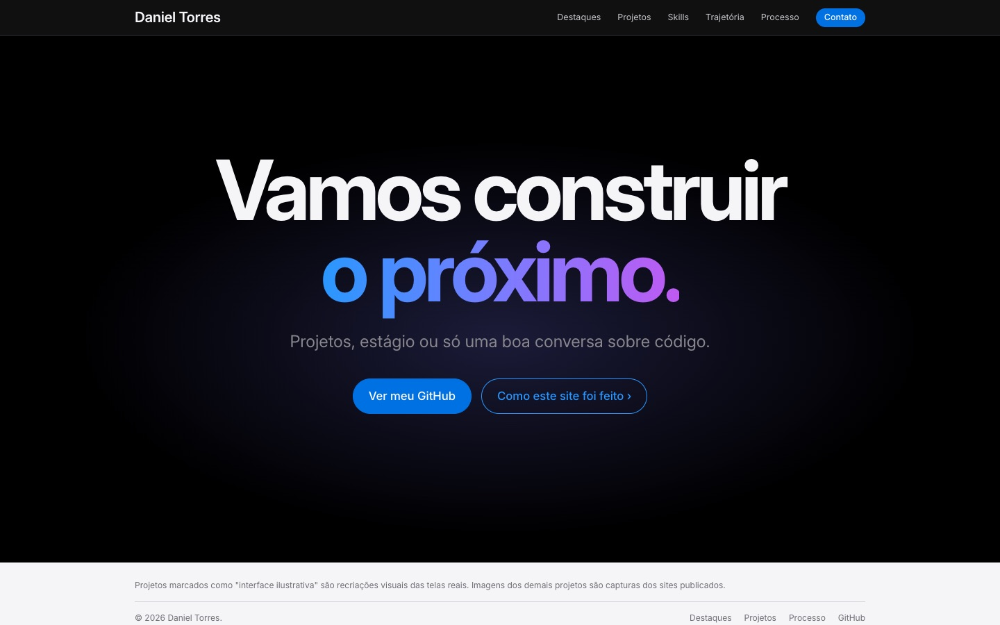
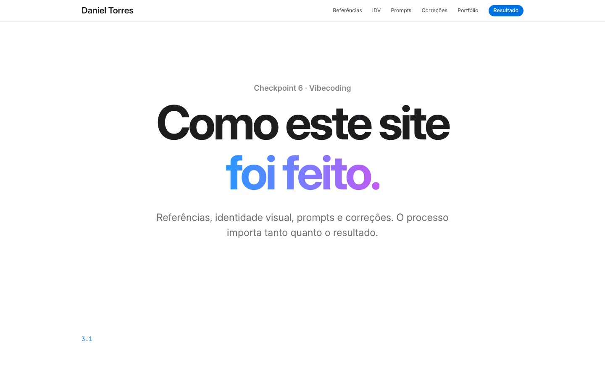
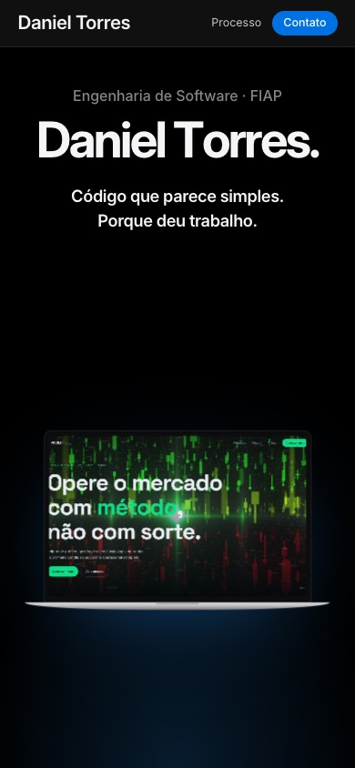
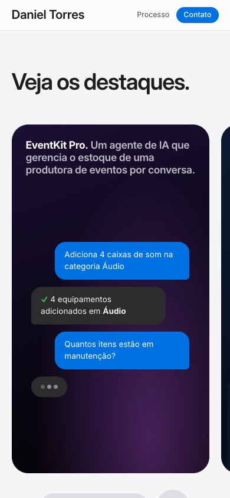

# 3.5 Resultado final e reflexão

## Links

- **Deploy:** https://portfolio-daniel-torres-three.vercel.app
- **Página de processo:** https://portfolio-daniel-torres-three.vercel.app/processo.html
- **Repositório:** https://github.com/D4NIELT0RRES/portfolio-daniel

## Prints do resultado

| Desktop (1440px) | |
|---|---|
|  |  |
|  |  |
|  |  |
|  |  |

| Celular (390px) | |
|---|---|
|  |  |

## Reflexão

**O que ficou como imaginei:** o clima de vitrine. O notebook que cresce no hero, o manifesto que acende palavra por palavra e os projetos tratados como produtos ficaram muito próximos do que eu tinha em mente quando escolhi as páginas de produto da Apple como referência. A página de processo também funcionou: o avaliador consegue ver o resultado e o caminho até ele no mesmo lugar.

**O que ainda mudaria:** primeiro, colocar o EventKit Pro e o BuscaGlobal no ar. Hoje eles aparecem como interfaces ilustrativas, e um portfólio fica mais forte com capturas de produtos reais. Segundo, escolher referências além da Apple: quase toda a minha pesquisa veio de uma única fonte, e isso limita o repertório. Terceiro, definir minha própria paleta em vez de partir dos tons da Apple.

**O que aprendi sobre escrever prompts:** meu prompt inicial era curto e vago ("parecido com a Apple", "com a mesma perfeição"), e quase todos os erros que apareceram vinham dessa vagueza: conteúdo sem lista fechada, animações sem estado inicial e final, nenhum pedido de teste em celular. Aprendi a pedir uma coisa por vez, a descrever como cada animação começa e termina e a exigir QA com resoluções definidas. Também aprendi que a IA entrega rápido, mas quem precisa abrir a página, clicar em tudo e desconfiar do resultado sou eu.
